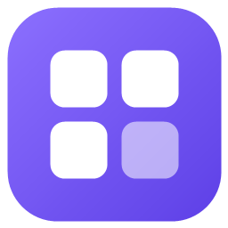
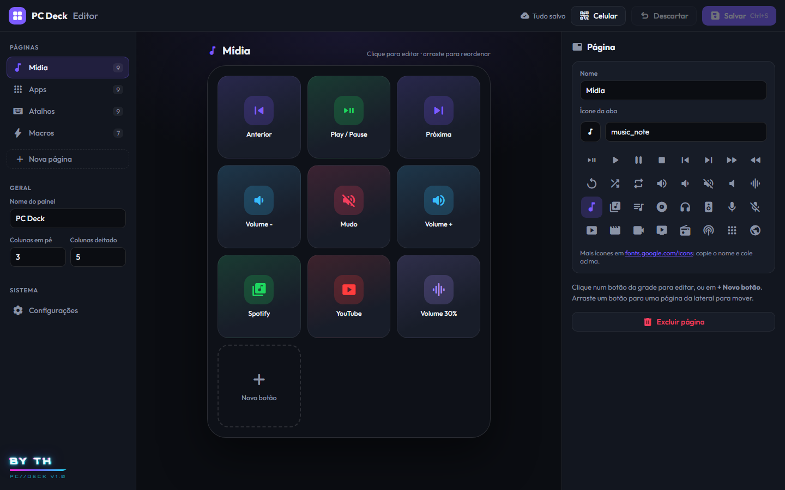

<p align="center">
  
</p>

<h1 align="center">PC Deck</h1>

<p align="center">
  Transforme um celular parado num painel estilo <b>Stream Deck</b> para controlar o PC pelo Wi-Fi.<br>
  Mídia, volume, apps, atalhos de teclado e macros, com um editor visual no computador.
</p>

<p align="center">
  
</p>

## Recursos

- **Painel no celular** pelo navegador, sem instalar app: funciona em Android e iPhone e pode ser adicionado à tela inicial
- **Tocando agora**: capa, título e artista do que está tocando (Spotify, YouTube, Chrome...), com play/pause, anterior e próxima. O player só aparece enquanto algo toca e pode ser desligado em *Configurações*.
- **Volume do Windows** com barra deslizante e mudo, além de CPU e RAM em tempo real
- **Botões configuráveis**: atalhos de teclado, abrir apps/sites/pastas, digitar texto, comandos PowerShell, volume e mídia
- **Macros**: várias ações em sequência num botão só, com pausas entre elas
- **Botões protegidos**: ações perigosas (desligar, fechar janela) só disparam segurando o botão
- **Editor visual no PC**:
  - páginas e botões com arrastar e soltar
  - mais de 200 ícones e cores
  - gravador de atalhos e lista de apps instalados
  - botão "Testar no PC"
- **Atualização ao vivo**: salvou no editor, o celular atualiza sozinho
- **App de bandeja** que inicia com o Windows, sem janela aberta
- **Tela de configurações** com o IP em uso e um passo a passo para fixar o IP no roteador
- **Português e inglês**: troque em *Configurações → Idioma*; vale para o editor, o celular e o menu do ícone
- **Leve**: um único `.exe` de ~240 KB, sem dependências (usa o .NET Framework que já vem no Windows)

## Instalação

1. Baixe o `PCDeck-Setup.exe` na página de [Releases](../../releases).
2. Execute. **Não precisa de administrador.**
   - Como o executável não é assinado, o Windows pode mostrar *"O Windows protegeu o computador"*. Clique em **Mais informações → Executar assim mesmo**.
3. Na primeira vez, o Windows pergunta sobre o **firewall**: permita em **redes privadas**, senão o celular não conecta.
4. Escaneie o QR code que aparece com a câmera do celular (o celular precisa estar no mesmo Wi-Fi do PC).

Para desinstalar: **Configurações → Aplicativos → Aplicativos instalados → PC Deck**.

## Como usar

- O PC Deck fica no **ícone perto do relógio**. Se não aparecer, clique na setinha **^** da bandeja.
  - **Clique** no ícone para abrir o editor dos botões.
  - **Botão direito** para mostrar o QR code do celular, iniciar com o Windows, abrir a pasta dos dados ou sair.
- **No celular:**
  - Toque nos botões.
  - Deslize para os lados para trocar de página.
  - Use o botão ⛶ para tela cheia.
  - Para virar "app": Android ⋮ → *Adicionar à tela inicial*; iPhone Compartilhar → *Adicionar à Tela de Início*.

### IP do PC

O celular acessa o PC pelo IP da rede local (ex.: `192.168.1.20`). Esse IP é dado pelo roteador e **pode mudar**. Em **Editor → Configurações** você vê o IP atual e um tutorial para fazer a **reserva de IP (DHCP)** no roteador, que mantém o endereço fixo.

## Ações disponíveis

O editor monta tudo visualmente, mas os botões ficam em `%APPDATA%\PC Deck\config.json` e também podem ser editados à mão. O celular atualiza sozinho.

```json
{ "label": "Nome", "icon": "rocket_launch", "color": "#7c5cff", "confirm": true, "actions": [ ... ] }
```

| Tipo | Exemplo | O que faz |
|---|---|---|
| `keys` | `{ "type": "keys", "keys": "ctrl+shift+esc" }` | Atalho de teclado |
| `media` | `{ "type": "media", "key": "play_pause" }` | `play_pause`, `next`, `prev`, `stop` |
| `volume` | `{ "type": "volume", "step": 5 }` | `set` (0-100), `step` (+/-), `mute` (`true`/`false`/`"toggle"`) |
| `open` | `{ "type": "open", "target": "C:\\Jogos\\jogo.exe", "args": "-x" }` | Abre programa, pasta, site ou `ms-settings:` |
| `run` | `{ "type": "run", "cmd": "shutdown /a" }` | Comando PowerShell (oculto; `"show": true` mostra a janela) |
| `text` | `{ "type": "text", "text": "Olá\nmundo" }` | Digita texto (`\n` = Enter) |
| `wait` | `{ "type": "wait", "ms": 500 }` | Pausa entre os passos |
| `page` | `{ "type": "page", "to": "Apps" }` | Troca a página no celular |

**Teclas aceitas:** `a`-`z`, `0`-`9`, `f1`-`f24`, `ctrl`, `shift`, `alt`, `win`, `enter`, `esc`, `tab`, `space`, `backspace`, `delete`, `up`/`down`/`left`/`right`, `home`, `end`, `pgup`, `pgdn`, `printscreen`, `num0`-`num9`, `comma`, `period`, `minus`, `equals`, `vol_up`, `vol_down`, `mute`.

**Ícones:** qualquer nome de [Material Symbols](https://fonts.google.com/icons?icon.set=Material+Symbols&icon.style=Rounded).

## Dados

Os dados ficam em `%APPDATA%\PC Deck`:

| Arquivo | O que é |
|---|---|
| `config.json` | Páginas e botões. A versão anterior fica em `config.bak.json`. |
| `token.txt` | Chave de acesso do celular. Apague para gerar outra; aí precisa escanear o QR de novo. |
| `log.txt` | Registro de toques e erros. |
| `language.txt` | Idioma escolhido (`pt` ou `en`). Sem ele, o PC Deck segue o idioma do Windows. |

## Segurança

- O celular só funciona com o **token** do QR code. Sem ele, ninguém na rede consegue usar os botões.
- O **editor** e a troca de botões só funcionam **no próprio PC** (`127.0.0.1`). Pelo celular não dá para criar nem alterar ações.
- A conexão é HTTP simples na rede local, sem criptografia. Use em redes de confiança (casa), não em Wi-Fi público.

## Compilando

Não precisa instalar nada: o build usa o compilador C# do .NET Framework 4.x que vem no Windows.

```powershell
powershell -ExecutionPolicy Bypass -File build.ps1
```

Isso gera `dist\PCDeck-Setup.exe` (e o ícone `deck.ico`). Para atualizar uma instalação existente, rode o setup de novo, ou use `PCDeck-Setup.exe --silent` para atualizar sem janela. Os botões são mantidos.

Ao criar uma tag `v*` no GitHub, o workflow em `.github/workflows/build.yml` compila e publica o `.exe` na release.

### Estrutura

```
src/App.cs       app de bandeja, servidor HTTP, ações e "tocando agora" (WinRT)
src/Native.cs    teclado (SendInput), volume (Core Audio), CPU/RAM e HTTP
src/Setup.cs     instalador e desinstalador (por usuário, sem admin)
web/index.html   painel do celular
web/editor.html  editor dos botões
web/qr.html      página do QR code
config.json      botões padrão de uma instalação nova (config.en.json em inglês)
build.ps1        gera o ícone e compila o .exe (com a pasta web embutida)
```

## English

PC Deck turns a spare phone into a **Stream Deck-style** panel to control your Windows PC over Wi-Fi: media, volume, apps, keyboard shortcuts and macros, with a visual editor on the PC. The app is available in **English and Portuguese** (*Settings → Language*). On a new install it follows the Windows language.

1. Download `PCDeck-Setup.exe` from [Releases](../../releases) and run it. No administrator rights needed.
   - The executable is not signed. If Windows shows *"Windows protected your PC"*, click **More info → Run anyway**.
2. Allow PC Deck through the **firewall** on **private networks**.
3. Scan the QR code with your phone (same Wi-Fi as the PC).
4. Click the tray icon near the clock to open the button editor.

## Licença

[MIT](LICENSE)

<p align="center"><b>BY TH</b></p>
